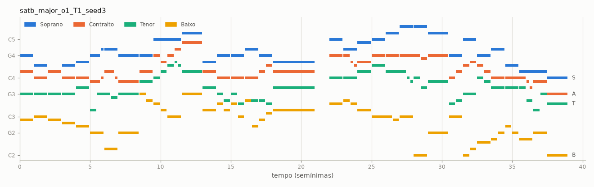
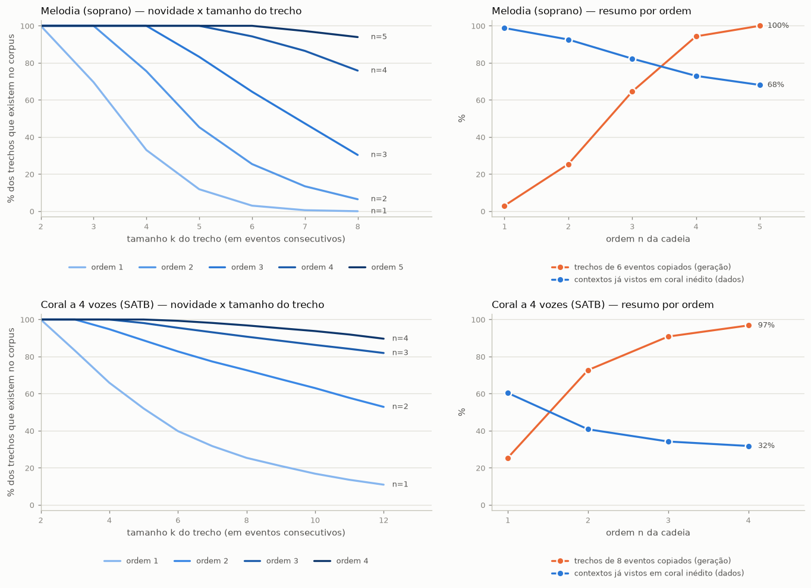
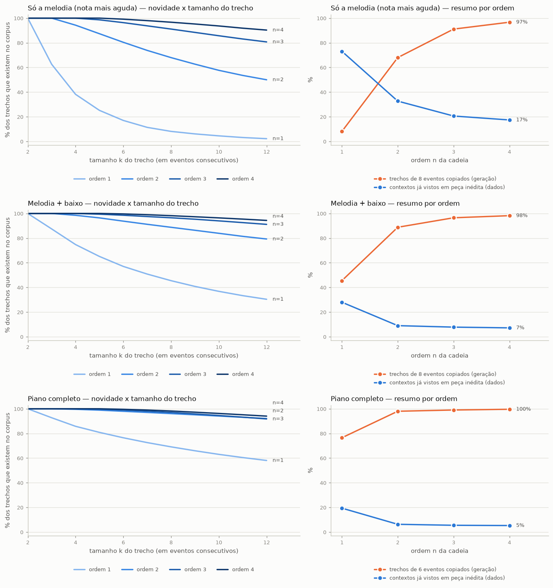

# Corais de Bach com Cadeias de Markov

**TP1 – Composição Musical Algorítmica** (DCC831 · IA Generativa para Música · UFMG · 2026/2)

Um compositor automático que **aprende com 307 corais de J. S. Bach** e escreve corais novos usando
**cadeias de Markov de ordem *n***. A saída de cada execução é um arquivo **MIDI** (música simbólica),
acompanhado de um `.wav` para audição, um piano-roll (`.png`) e um `.json` com os parâmetros usados.



*Coral gerado com `python generate.py --seed 3` (ordem 1, modo maior). Azul = soprano, laranja = contralto,
verde = tenor, amarelo = baixo. As pausas entre blocos são as "respirações" das fermatas.*

---

## Sumário

1. [Início rápido](#1-início-rápido)
2. [Cadeias de Markov em 5 minutos](#2-cadeias-de-markov-em-5-minutos)
3. [Como a música vira "estados"](#3-como-a-música-vira-estados)
4. [A ferramenta de manipulação simbólica: music21](#4-a-ferramenta-de-manipulação-simbólica-music21)
5. [Como o código funciona](#5-como-o-código-funciona)
6. [Guia de uso e hiperparâmetros](#6-guia-de-uso-e-hiperparâmetros)
7. [Escolha da ordem: o experimento](#7-escolha-da-ordem-o-experimento)
8. [Reproduzindo os resultados e ouvindo as peças](#8-reproduzindo-os-resultados-e-ouvindo-as-peças)
9. [Testes](#9-testes)
10. [Limitações e extensões](#10-limitações-e-extensões)
- **Extra:** [música nova a partir dos seus próprios MIDIs (Undertale)](#extra-música-nova-a-partir-dos-seus-próprios-midis-exemplo-undertale)
11. [Declaração de uso de IA](#11-declaração-de-uso-de-ia)
12. [Referências](#12-referências)

**Restrição estilística escolhida:** *coral a quatro vozes no estilo de J. S. Bach*, em compasso 4/4, formado por
frases que terminam em fermata e uma **cadência final com a tônica no baixo** (Dó em modo maior, Lá em modo menor).
Detalhes na [seção 3](#3-como-a-música-vira-estados).

**Checklist do enunciado**

| Requisito do enunciado | Onde está |
|---|---|
| Cadeias de Markov, ordem definida e justificada | [Seção 7](#7-escolha-da-ordem-o-experimento) (experimento com números) |
| Probabilidades aprendidas de um corpus real | Corpus de Bach do music21 – [seção 3](#3-como-a-música-vira-estados) |
| Trade-off ordem baixa × ordem alta | [Seção 2.3](#23-a-ordem-n-a-memória-da-cadeia) e [seção 7](#7-escolha-da-ordem-o-experimento) |
| Saída simbólica reproduzível (`.mid`) | `generate.py` grava `.mid` em `--out` |
| Várias músicas da mesma configuração | `--count` / `--seed` ([exemplos A](#8-reproduzindo-os-resultados-e-ouvindo-as-peças)) |
| Variar ≥ 1 hiperparâmetro | `--order`, `--temperature`, `--mode`, `--texture`, `--max-copy` |
| README com instalação e reprodução | Seções [1](#1-início-rápido) e [8](#8-reproduzindo-os-resultados-e-ouvindo-as-peças) |
| `requirements.txt` | [requirements.txt](requirements.txt) |
| ≥ 3 músicas em áudio no repositório | Pasta [`examples/`](examples/) (15 peças, cada uma com `.wav`) |
| Declaração de uso de IA | [Seção 11](#11-declaração-de-uso-de-ia) |

---

## 1. Início rápido

**Requisitos:** Python 3.10 ou superior (testado com 3.14). Não é preciso instalar nada além do que está em
[requirements.txt](requirements.txt): o corpus de Bach já vem dentro do pacote `music21`.

```bash
# 1) crie e ative um ambiente virtual
python -m venv .venv
source .venv/bin/activate            # Linux / macOS
.venv\Scripts\Activate.ps1           # Windows (PowerShell)  | no cmd: .venv\Scripts\activate.bat

# 2) instale as dependências
pip install -r requirements.txt

# 3) gere seu primeiro coral
python generate.py
```

> **Windows:** se o PowerShell reclamar de política de execução, rode antes
> `Set-ExecutionPolicy -Scope Process Bypass`. Se `python` não for reconhecido, use `py`.

Na **primeira execução** o programa lê os 371 corais do music21, descobre a tonalidade de cada um e guarda o
resultado em `.cache/` (leva de 30 s a 1 min). As execuções seguintes são imediatas.

Você verá algo assim:

```text
Treinando: textura=satb, modo=major, ordem=1 ...
  978 frases de treino | 6925 contextos | média de 1.39 continuações por contexto | 83% dos contextos sem escolha
[1/1] output/satb_major_o1_T1_seed1.mid  (32s, 155 notas, 68% dos trechos de 8 eventos copiados do corpus)
```

e a pasta `output/` terá quatro arquivos com o mesmo nome:

| Arquivo | O que é |
|---|---|
| `satb_major_o1_T1_seed1.mid` | **a peça** (resultado oficial do sistema, música simbólica) |
| `satb_major_o1_T1_seed1.wav` | áudio sintetizado a partir do `.mid`, só para ouvir |
| `satb_major_o1_T1_seed1.png` | piano-roll |
| `satb_major_o1_T1_seed1.json` | parâmetros, semente e métricas (reprodutibilidade) |

Abra o `.wav` em qualquer player. O `.mid` abre em MuseScore, VLC (com soundfont), GarageBand, DAWs etc.

Mais exemplos de uso:

```bash
python generate.py --count 3 --seed 10          # 3 corais DIFERENTES (sementes 10, 11 e 12)
python generate.py --mode minor                 # coral em modo menor
python generate.py --texture melody             # só a melodia (soprano)
python generate.py --order 2 --max-copy 0.3     # ordem 2, mas recusando frases copiadas demais
```

---

## 2. Cadeias de Markov em 5 minutos

### 2.1 A ideia

Uma **cadeia de Markov** gera uma sequência um passo de cada vez. A regra é:

> **a probabilidade do próximo estado depende apenas dos últimos *n* estados**, e não de todo o passado.

Em música, um "estado" pode ser uma nota, um acorde ou (no nosso caso) uma nota/acorde junto com sua duração.
Para *aprender* as probabilidades basta **contar**: percorremos músicas reais e anotamos, para cada trecho de
*n* estados, o que veio logo depois.

### 2.2 Exemplo de brinquedo (você pode refazer à mão)

Treinamos com apenas duas melodias de três notas, cada uma terminando num marcador `FIM`:

```text
melodia 1:  Dó  Ré  Mi  FIM
melodia 2:  Sol Ré  Si  FIM
```

**Ordem 1** (lembra só da última nota). Tabela de contagens → probabilidades:

| Contexto (última nota) | Próximo estado e probabilidade |
|---|---|
| `INÍCIO` | Dó 50 % · Sol 50 % |
| Dó | Ré 100 % |
| Sol | Ré 100 % |
| **Ré** | **Mi 50 % · Si 50 %** |
| Mi / Si | FIM 100 % |

Para gerar: começa em `INÍCIO`, sorteia uma nota, depois sorteia a seguinte olhando só para a anterior, e
para ao sortear `FIM`. Como depois de `Ré` tanto `Mi` quanto `Si` são possíveis, a cadeia pode produzir
**4 melodias**: as 2 de treino **mais 2 inéditas** (`Dó Ré Si` e `Sol Ré Mi`).

**Ordem 2** (lembra das duas últimas notas). Agora o contexto de `Ré` é `(Dó, Ré)` ou `(Sol, Ré)`, e cada um
só tem uma saída (`Mi` ou `Si`). A cadeia **só consegue reproduzir as 2 melodias de treino**.

Esse minúsculo exemplo já mostra o dilema central do trabalho. Ele está verificado em
[`tests/test_markov.py`](tests/test_markov.py) (`test_readme_toy_example_order_1_invents_order_2_copies`).

### 2.3 A ordem *n*: a memória da cadeia

| | **Ordem baixa** (1, 2) | **Ordem alta** (4, 5, …) |
|---|---|---|
| Memória | curta: só o passado imediato | longa: lembra de trechos inteiros |
| Contextos possíveis | poucos, muito repetidos nos dados | muitos, quase todos vistos **uma única vez** |
| Escolhas por passo | várias | quase nenhuma (cadeia determinística) |
| Resultado | **novidade**, mas pode soar genérico/aleatório | **fidelidade** ao estilo, mas **memoriza** e copia trechos inteiros |

A ordem 1 só garante que cada *par* de estados vizinhos exista no corpus; o resto é sorte. Com ordem muito
alta o contexto é tão específico que existe só em um coral de Bach, então a cadeia "reconhece" em qual
coral está e o **recita**. Medimos isso na [seção 7](#7-escolha-da-ordem-o-experimento).

### 2.4 Temperatura

Depois de contar, podemos **achatar ou afiar** as probabilidades antes de sortear: `p ∝ contagem^(1/T)`.
Exemplo real do modelo de melodia: depois de um Sol4 no tempo 1 (131 observações no corpus):

| Próxima nota | T = 0,5 | **T = 1 (corpus)** | T = 2 |
|---|---|---|---|
| Sol (repete) | 68 % | **35 %** | 18 % |
| Lá | 13 % | **15 %** | 12 % |
| Fá | 10 % | **14 %** | 11 % |
| Fá♯ | 4 % | **8 %** | 9 % |

`T < 1` favorece o mais comum (previsível); `T > 1` aproxima tudo de equiprovável (arriscado).

---

## 3. Como a música vira "estados"

### 3.1 Corpus e estilo

* **Corpus:** os 371 corais de J. S. Bach do `music21.corpus` (Bach harmonizando melodias de coral).
* **Filtros:** ficam os corais com **4 vozes e compasso 4/4 constante** → **307 corais** (152 em modo maior,
  155 em menor). Descartados: 20 sem 4 vozes, 35 em 3/4, 3 com outras fórmulas de compasso (3/2 ou compasso misto) e 6 com compassos irregulares.
* **Normalização de tonalidade:** a tonalidade de cada coral é estimada pelo algoritmo de
  Krumhansl–Schmuckler (`score.analyze("key")`) e o coral é transposto para **Dó maior** ou **Lá menor** (menor
  deslocamento possível). Assim "Dó" significa "tônica" em todo o corpus e a cadeia aprende **funções**, não
  tonalidades. Modo maior e menor são treinados em **modelos separados** (`--mode`).
* **Frases:** as **fermatas** do soprano marcam o fim das frases. Cada coral vira ~6 frases.

### 3.2 O estado: `Event`

Em [`markov_music/corpus.py`](markov_music/corpus.py):

```python
@dataclass(frozen=True)
class Event:
    pos: int                   # posição dentro do compasso, em ticks (12 ticks = 1 semínima)
    pitches: Tuple[int, ...]   # altura MIDI de cada voz (-1 = pausa)
    attacks: Tuple[bool, ...]  # a voz tocou uma nota NOVA aqui? (False = continua soando)
    dur: int                   # duração em ticks
```

Eventos reais do início de um coral (melodia e depois as 4 vozes):

```text
Event(pos=36, pitches=(72,),              attacks=(True,),                   dur=6)   # só soprano: Dó5, colcheia no 4º tempo
Event(pos=42, pitches=(74,),              attacks=(True,),                   dur=6)   # Ré5
Event(pos=0,  pitches=(76,),              attacks=(True,),                   dur=12)  # Mi5, semínima no 1º tempo do compasso

Event(pos=36, pitches=(72, 67, 64, 48),   attacks=(True, True, True, True),  dur=6)   # acorde de Dó maior a 4 vozes
Event(pos=42, pitches=(74, 67, 65, 48),   attacks=(True, False, True, False), dur=6)  # contralto e baixo SUSTENTAM
```

Por que cada campo está no estado?

| Campo | Para quê |
|---|---|
| `pitches` | melodia e harmonia (as 4 vozes juntas formam o acorde) |
| `dur` | ritmo |
| `pos` | **métrica**: a cadeia aprende que notas longas caem em tempos fortes e que frases começam em anacruse (`pos=36`, 4º tempo) |
| `attacks` | distingue **nota repetida** (`True, True`) de **nota sustentada** (`True, False`) |

### 3.3 Duas "texturas"

`--texture` escolhe o que é um estado, e portanto o que a cadeia modela:

| Textura | Estado | Corpus (modo maior) | Estados distintos |
|---|---|---|---|
| `melody` | uma nota do soprano | 7 780 eventos | 336 |
| `satb` (padrão) | uma "fatia vertical" com as 4 vozes | 12 636 eventos | 6 924 |

A fatia vertical é o trecho entre dois instantes consecutivos em que **qualquer voz muda**. Cada fatia é um
acorde completo (inclusive com as notas de passagem das vozes internas), e a condução de cada voz que Bach escreveu é herdada "de graça".

### 3.4 Regras de estilo (a "restrição estilística")

A cadeia só sabe de transições. As regras do coral entram por **amostragem por rejeição**
(sorteia uma frase; se violar a regra, descarta e sorteia outra):

1. **Forma:** a peça tem `--phrases` frases (padrão 5). Cada frase termina num marcador `FIM_DE_FRASE` (fermata);
   a última termina em `FIM_DA_PECA`. Os dois marcadores fazem parte do vocabulário da cadeia, então ela
   **aprende sozinha quando uma frase deve acabar**.
2. **Encaixe métrico:** se uma frase termina na posição *p* do compasso, a seguinte **precisa começar em *p***.
3. **Cadência final:** a última frase termina com a **tônica no grave** (Dó em maior, Lá em menor).
4. **Fermata:** na hora de tocar, a última fatia de cada frase é alongada (`--fermata`, padrão 1,5×).
5. *(opcional)* **Anti-plágio** (`--max-copy`): recusa frases com muitos trechos copiados do corpus
   ([seção 7.4](#74-botão-anti-plágio---max-copy)).

---

## 4. A ferramenta de manipulação simbólica: music21

Escolhi o **[music21](https://web.mit.edu/music21/)**. O critério foi: *o que este projeto precisa tirar da
partitura que um arquivo MIDI não tem?*

| Necessidade do projeto | **music21** | pretty_midi | MusPy | MidiTok |
|---|:---:|:---:|:---:|:---:|
| Corpus de Bach **embutido** (funciona offline, sem baixar nada) | ✅ | ❌ | datasets (precisam de download) | ❌ |
| Informação de **partitura**: fermatas, ligaduras, anacruse, compassos | ✅ | ❌ (só eventos MIDI) | parcial | ❌ |
| **Análise** de tonalidade (para transpor) | ✅ `analyze("key")` | ❌ | ❌ | ❌ |
| Ler/escrever MIDI | ✅ | ✅ (mais simples) | ✅ | ✅ |
| Foco | musicologia computacional | manipulação de MIDI | datasets p/ deep learning | tokenização p/ modelos neurais |

* Para **segmentar frases** preciso das **fermatas**, que não existem em MIDI.
* Para **normalizar a tonalidade** preciso de análise de tonalidade.
* Para **alinhar a métrica** preciso saber onde começam os compassos, inclusive com **anacruse**.
* O corpus já vem no pacote. Nenhuma das outras três entrega essas três coisas juntas.

O `pretty_midi` seria ótimo só para ler/escrever MIDI e o MidiTok para alimentar redes neurais; não é o caso aqui.

> *Nota:* a coluna do music21 foi verificada neste projeto; as colunas das demais bibliotecas resumem o que
> a documentação delas descreve e **não foram testadas aqui**.

> **Onde o music21 é usado:** leitura do corpus e análise de tonalidade em `corpus.py`; escrita do `.mid` em
> `midi_io.py` (`stream.Score`, `stream.Part`, `note.Note`, `tempo.MetronomeMark`...); leitura dos eventos MIDI
> brutos (`music21.midi`) para sintetizar o áudio.

---

## 5. Como o código funciona

### 5.1 Visão geral

```text
 corpus de Bach (music21)
        │  corpus.load_raw_chorales   lê, descobre a tonalidade, transpõe, acha fermatas  (com cache)
        ▼
   RawChorale ──► corpus.slice_chorale ──► Phrase = [Event, Event, ...]     "texto" que a cadeia lê
                                               │
                                               ▼  generator.training_sequences   (+ marcador de fim)
                                         MarkovChain.fit  ──►  tabela { contexto → contagens dos próximos }
                                               │
                                               ▼  ChoraleModel.compose   sorteia frases + regras de estilo
                                             Piece  (lista de frases de Event)
                                               │  midi_io.piece_to_notes
                          ┌────────────────────┼─────────────────────┐
                          ▼                    ▼                     ▼
                   midi_io.write_midi     plots.save_piano_roll   (mesma lista de notas)
                       (.mid)                  (.png)
                          │ midi_io.read_midi_seconds
                          ▼
                   audio.render_wav  (.wav)
```

| Arquivo | Responsabilidade |
|---|---|
| [`markov_music/markov.py`](markov_music/markov.py) | `MarkovChain`: **só matemática**, funciona com qualquer token (nenhuma música aqui) |
| [`markov_music/corpus.py`](markov_music/corpus.py) | partitura (music21) → `Event`s; transposição, fermatas, métrica |
| [`markov_music/generator.py`](markov_music/generator.py) | `ChoraleModel`: usa a cadeia + regras de estilo para compor |
| [`markov_music/midi_io.py`](markov_music/midi_io.py) | `Event`s → notas → arquivo `.mid`, e a leitura de volta |
| [`markov_music/audio.py`](markov_music/audio.py) | sintetizador (só NumPy) para ouvir o `.mid` |
| [`markov_music/plots.py`](markov_music/plots.py) | piano-roll |
| [`markov_music/metrics.py`](markov_music/metrics.py) | métrica de estilo: quintas/oitavas paralelas |
| [`generate.py`](generate.py) | linha de comando principal |
| [`render_audio.py`](render_audio.py) | converte qualquer `.mid` em `.wav` |
| [`experiment_orders.py`](experiment_orders.py) | experimento da ordem (gera a tabela e o gráfico da seção 7) |
| [`reproduce_all.py`](reproduce_all.py) | refaz todos os exemplos e figuras |

### 5.2 O coração: `MarkovChain` ([markov.py](markov_music/markov.py))

**Treino** é só contar. `START` é um marcador que "enche" o começo de cada sequência para que as primeiras
escolhas também tenham um contexto de tamanho *n*:

```python
def fit(self, sequences):
    for seq in sequences:
        padded = [START] * self.order + list(seq)
        for i in range(self.order, len(padded)):
            context = tuple(padded[i - self.order:i])                    # os n estados anteriores
            self.counts.setdefault(context, Counter())[padded[i]] += 1   # +1 para "o que veio depois"
```

O resultado é `counts`, um dicionário `contexto → Counter({próximo: contagem})`. Probabilidade = contagem ÷ total
(com a temperatura aplicada em `_weights`).

**Geração** é uma janela deslizante de tamanho *n* (versão simplificada de `generate`):

```python
context = (START,) * self.order
while True:
    token = self.sample_next(context, rng, temperature)    # sorteio ponderado pelas contagens
    out.append(token)
    if token in stop_tokens:                               # sorteou FIM_DE_FRASE / FIM_DA_PECA: terminou
        return out
    context = context[1:] + (token,)                       # descarta o mais antigo, acrescenta o novo
```

Como todo contexto gerado vem de uma transição observada, a cadeia **nunca fica sem saída**: toda sequência de
treino termina num marcador de fim, e é ele que encerra a geração.

### 5.3 Do corpus aos eventos ([corpus.py](markov_music/corpus.py))

`load_raw_chorales` (uma vez, ~30 s, depois vem do cache):

1. `corpus.parse(...)` abre cada coral; descarta os que não têm 4 vozes / 4/4 / só notas simples.
2. `score.analyze("key")` estima a tonalidade → calcula a transposição (−6 a +5 semitons).
3. `_extract_voice` converte cada voz em `(início, fim, altura)` em *ticks*, **juntando notas ligadas**
   (ligaduras) e anotando onde há **fermata** no soprano.
4. A **origem do compasso** vem do `beat` da primeira nota do soprano, o que trata a anacruse corretamente.
   Corais com compassos completos fora da grade 4/4 são descartados.

`slice_chorale` (a cada treino, instantâneo): junta os instantes em que alguma voz muda (`bounds`), percorre
as fatias com um ponteiro por voz e cria um `Event` para cada uma, fechando uma `Phrase` sempre que a fatia
termina onde há fermata.

### 5.4 Compondo ([generator.py](markov_music/generator.py))

```python
model = train_model(order=1, texture="satb", mode="major")
piece = model.compose(n_phrases=5, seed=1, temperature=1.0)
```

`compose` sorteia **frase por frase**. Para cada uma, `_compose_phrase` repete até valer:

```text
repita (até 5000 vezes):
    seq = cadeia.generate(...)                  # uma frase inteira, até sortear um marcador de fim
    se a frase é curta demais (< 4 eventos)                          → descarta
    se é a última frase:   precisa terminar em FIM_DA_PECA e com a tônica no grave  → senão descarta
    senão:                 precisa terminar em FIM_DE_FRASE e deixar um ponto métrico
                           onde frases reais começam                                → senão descarta
    se --max-copy foi dado e a frase copia demais o corpus                          → descarta
    devolve a frase
```

Além disso, o primeiro evento de cada frase é **filtrado** para começar exatamente na posição métrica onde a
anterior terminou (`accept_first` em `MarkovChain.generate`). Se for impossível satisfazer tudo (ordem altíssima
+ `--max-copy` baixo, por exemplo), o programa para com uma mensagem explicando o que ajustar.

### 5.5 Do evento ao som ([midi_io.py](markov_music/midi_io.py), [audio.py](markov_music/audio.py))

* `piece_to_notes` transforma eventos em notas `(início, duração, altura, voz)`. Voz que **não ataca** e repete a
  altura anterior apenas **prolonga** a nota; a fatia final de cada frase é alongada pelo fator de fermata;
  o silêncio inicial é cortado, mas as pausas entre frases (a respiração) ficam.
* `write_midi` cria um `Score` do music21 com **uma trilha por voz** (instrumento General MIDI 19 = órgão de
  igreja) e depois coloca cada voz em seu próprio **canal MIDI**, para que uma nota de uma voz nunca corte a de
  outra quando duas vozes dobram a mesma altura.
* `read_midi_seconds` lê os eventos `note_on`/`note_off` do arquivo, então o áudio vem **do `.mid`**, a saída
  oficial, e não de estruturas internas.
* `render_wav` é um sintetizador aditivo (soma de harmônicos de órgão, envelope suave, reverberação por
  convolução). Não é um instrumento realista, mas dá para ouvir a harmonia e a condução das vozes.

> **Timbre melhor (opcional):** FluidSynth com um soundfont livre, por exemplo
> `fluidsynth -ni SeuSoundfont.sf2 arquivo.mid -F saida.wav -r 44100`. *Não testei esta rota neste repositório*
> (o Windows em que desenvolvi bloqueou o binário do FluidSynth). Os áudios entregues usam o sintetizador embutido.

---

## 6. Guia de uso e hiperparâmetros

```bash
python generate.py [opções]          # veja tudo com:  python generate.py --help
```

| Opção | Padrão | O que faz |
|---|---|---|
| `--order N` | 1 (`satb`) · 2 (`melody`) | **ordem da cadeia**: quantos estados anteriores ela lembra |
| `--temperature T` | 1.0 | `<1` mais previsível · `>1` mais aleatório |
| `--mode major\|minor` | major | corpus de treino (corais em maior ou menor) |
| `--texture satb\|melody` | satb | coral a 4 vozes **ou** só a melodia |
| `--max-copy F` | desligado | anti-plágio: recusa frases com mais de F (0–1) dos trechos copiados |
| `--phrases N` | 5 | número de frases |
| `--seed S` | 1 | semente: **mesma semente + mesmos parâmetros = mesma música** |
| `--count K` | 1 | gera K peças com sementes S, S+1, … |
| `--bpm`, `--fermata`, `--program` | 76 · 1.5 · 19 | andamento, alongamento da fermata, instrumento MIDI |
| `--out DIR` | `output` | pasta de saída |
| `--no-audio`, `--no-plot` | | pula o `.wav` / o `.png` |

Para sintetizar áudio de **qualquer** arquivo MIDI: `python render_audio.py meu.mid` (cria `meu.wav`).

**Receitas para explorar**

```bash
# Mesma configuração, músicas diferentes (só muda a semente)
python generate.py --count 5 --seed 100

# Efeito da ordem: mesma semente, ordens diferentes
python generate.py --texture melody --order 1 --seed 7
python generate.py --texture melody --order 4 --seed 7

# Ordem alta (coerência local) sem copiar o corpus (novidade global)
python generate.py --texture melody --order 4 --seed 7 --max-copy 0.3

# Cadeia mais "ousada" ou mais "conservadora"
python generate.py --texture melody --temperature 2.0
python generate.py --texture melody --temperature 0.5
```

Usando como **biblioteca** (por exemplo num notebook):

```python
from markov_music.generator import train_model
from markov_music.midi_io import piece_to_notes, write_midi

model = train_model(order=1, texture="satb", mode="minor")
piece = model.compose(n_phrases=4, seed=42)
print(model.copy_rate(piece))                       # fração de trechos copiados do corpus
write_midi(piece_to_notes(piece), "meu_coral.mid", bpm=72)
```

---

## 7. Escolha da ordem: o experimento

`python experiment_orders.py` (~30 s com o corpus já em cache) gera 60 peças de 4 frases para cada ordem (modo maior, sementes 0–59) e
mede o que muda. Resultados completos em [`docs/order_experiment.csv`](docs/order_experiment.csv).



### 7.1 O que cada métrica significa

| Métrica | Pergunta que responde |
|---|---|
| **Contextos / ramificação** | quantos contextos a cadeia tem e quantas continuações cada um oferece em média |
| **Contextos sem escolha** | em que fração dos contextos só existe **uma** continuação (nenhum sorteio de verdade) |
| **Cobertura em corais inéditos** | validação cruzada (5 partes): dos contextos de um coral que a cadeia **não treinou**, quantos ela já conhece? Mede o quão *esparsos* estão os dados |
| **Trechos de *k* copiados** | dos trechos de *k* eventos seguidos da peça gerada, quantos existem **idênticos** no corpus? (*k* = 6 na melodia, 8 no coral) |
| **Frases inteiras copiadas** | fração das frases geradas que são **idênticas** a uma frase de Bach |
| **Quintas/oitavas paralelas** | *(só coral a 4 vozes)* defeito clássico de condução de vozes, por 100 transições entre acordes, comparado com o próprio Bach (`markov_music/metrics.py`) |
| **Viabilidade do `--max-copy 0.3`** | em quantas de 40 sementes foi possível gerar a peça com a restrição anti-plágio, e quanta cópia restou |

### 7.2 Resultados

**Melodia (soprano)**

| Ordem *n* | Contextos | Ramificação média | Sem escolha | Cobertura em corais inéditos | Trechos de 6 copiados | Frases inteiras copiadas |
|:-:|--:|--:|--:|--:|--:|--:|
| 1 | 337 | 3,95 | 36 % | 99 % | 3 % | 1 % |
| **2** | 1 236 | 2,10 | 59 % | 93 % | 25 % | **5 %** |
| 3 | 2 303 | 1,53 | 73 % | 82 % | 64 % | 30 % |
| 4 | 3 084 | 1,32 | 82 % | 73 % | 94 % | 64 % |
| 5 | 3 506 | 1,24 | 87 % | 68 % | 100 % | 86 % |

**Coral a 4 vozes (SATB)**

| Ordem *n* | Contextos | Ramificação média | Sem escolha | Cobertura em corais inéditos | Trechos de 8 copiados | Frases inteiras copiadas |
|:-:|--:|--:|--:|--:|--:|--:|
| **1** | 6 925 | 1,39 | 83 % | 60 % | 25 % | **6 %** |
| 2 | 9 284 | 1,16 | 93 % | 41 % | 73 % | 45 % |
| 3 | 10 018 | 1,11 | 96 % | 34 % | 91 % | 74 % |
| 4 | 10 308 | 1,09 | 97 % | 32 % | 97 % | 89 % |

### 7.3 Interpretação e justificativa das ordens padrão

* **A esparsidade cresce rápido com a ordem.** Na melodia, passar da ordem 1 para a 5 multiplica os contextos
  por ~10, e a cobertura em corais inéditos cai de 99 % para 68 %: a memória "rica" demais quase nunca se
  repete em outro coral, ou seja, **está decorando** em vez de aprender o estilo.
* **A curva de novidade (painéis da esquerda)** mostra, para cada ordem, até que tamanho de trecho a peça
  gerada ainda é "plausível" (100 % dos trechos existem no corpus) e a partir de onde é nova. Por construção,
  uma cadeia de ordem *n* só garante que trechos de até *n*+1 eventos existam no corpus. Ordens baixas deixam de
  ser "reais" cedo (novidade, mas sem coerência de longo alcance); ordens altas continuam ~100 % reais (cópia).
* **Melodia → ordem 2 (padrão).** É a maior ordem que ainda tem baixa memorização (5 % de frases inteiras
  copiadas; 93 % de cobertura) e que garante que **cada trio** de notas consecutivas já aparece em Bach. A ordem
  3 já copia 30 % das frases inteiras.
* **Coral a 4 vozes → ordem 1 (padrão).** O espaço de estados é enorme (6 924 acordes distintos em 12 636
  eventos): já na ordem 2, 45 % das frases geradas são **cópias integrais** de uma frase de Bach, e 93 % dos
  contextos têm uma única continuação (na ordem 1, 83 %). A ordem 1 é a única que recombina de verdade: ela costura trechos de corais
  diferentes nos acordes que eles têm em comum.
* A variância entre sementes é grande (nos exemplos A, a ordem 1 do coral copia entre 19 % e 68 % dos trechos
  dependendo da semente). Por isso o `generate.py` mostra a taxa de cópia de cada peça.

### 7.4 Botão anti-plágio: `--max-copy`

Dá para ter **coerência local de ordem alta** sem a cópia: gerar com uma ordem alta, mas **rejeitar** frases em
que mais que uma fração `F` dos trechos de *k* eventos é cópia literal do corpus (a ideia de restringir
plágio em sequências de Markov é discutida por Papadopoulos, Roy e Pachet, 2014 – ver referências).

| Configuração (mesma semente) | Trechos copiados |
|---|---|
| Coral, ordem 2, sem restrição ([exemplo D](examples/D_ordem_coral/)) | 66 % |
| Coral, ordem 2, `--max-copy 0.3` ([exemplo F](examples/F_anti_plagio/)) | **6 %** |
| Melodia, ordem 4, sem restrição ([exemplo C](examples/C_ordem_melodia/)) | 87 % |
| Melodia, ordem 4, `--max-copy 0.3` ([exemplo F](examples/F_anti_plagio/)) | **0 %** |

Se a restrição for impossível (por exemplo, melodia de ordem 5 com `--max-copy 0.3`: a cadeia é quase
determinística), o programa avisa e sugere reduzir a ordem ou aumentar `--max-copy`. Medido sobre 40 sementes:

| Ordem *n* | Melodia: sementes viáveis | Melodia: cópia restante | Coral: sementes viáveis | Coral: cópia restante |
|:-:|:-:|:-:|:-:|:-:|
| 1 | 40/40 | 2 % | 40/40 | 7 % |
| 2 | 40/40 | 13 % | 40/40 | 14 % |
| 3 | 40/40 | 14 % | 40/40 | 15 % |
| 4 | 39/40 | 4 % | 15/40 | 16 % |
| 5 | **0/40** | – | – | – |

### 7.5 Condução de vozes: a emenda entre trechos de corais piora o resultado?

Costurar trechos de corais diferentes poderia criar quintas e oitavas paralelas nas junções. Medimos
quintas/oitavas paralelas (duas vozes que andam na mesma direção entre intervalos de quinta justa ou de oitava)
por 100 transições entre acordes consecutivos:

| | Bach (corpus) | ordem 1 | ordem 2 | ordem 3 | ordem 4 |
|---|:-:|:-:|:-:|:-:|:-:|
| Paralelas por 100 transições | 0,20 | 0,19 | 0,17 | 0,21 | 0,24 |

**Não houve piora mensurável** (as contagens são pequenas, então diferenças entre ordens estão dentro do ruído).
É um teste grosseiro: só detecta paralelismo literal entre fatias vizinhas.

> **Limite honesto da avaliação:** as métricas acima medem **memorização e esparsidade**, não "beleza". A
> qualidade musical deve ser avaliada **ouvindo** as peças de [`examples/`](examples/).

---

## 8. Reproduzindo os resultados e ouvindo as peças

Um único comando refaz **todas** as peças de `examples/` e a figura/tabela da seção 7 (~1 min):

```bash
python reproduce_all.py
```

Todas as sementes são fixas, então o resultado é idêntico em qualquer máquina com as mesmas versões de Python
e music21 (testado com Python 3.14.6 e music21 10.5.0). Cada peça traz `.mid`, `.wav`, `.png` e `.json`.
As sementes **não foram escolhidas a dedo**: são simplesmente 1, 2, 3, 4 e 7.

| Grupo | O que varia | Peças (áudio · MIDI · piano-roll) | Duração · cópia |
|---|---|---|---|
| **A** – mesma configuração, **sementes diferentes** (coral, maior, ordem 1) | semente 1 | [wav](examples/A_sementes_diferentes/satb_major_o1_T1_seed1.wav) · [mid](examples/A_sementes_diferentes/satb_major_o1_T1_seed1.mid) · [png](examples/A_sementes_diferentes/satb_major_o1_T1_seed1.png) | 32 s · 68 % |
| | semente 2 | [wav](examples/A_sementes_diferentes/satb_major_o1_T1_seed2.wav) · [mid](examples/A_sementes_diferentes/satb_major_o1_T1_seed2.mid) · [png](examples/A_sementes_diferentes/satb_major_o1_T1_seed2.png) | 42 s · 58 % |
| | semente 3 | [wav](examples/A_sementes_diferentes/satb_major_o1_T1_seed3.wav) · [mid](examples/A_sementes_diferentes/satb_major_o1_T1_seed3.mid) · [png](examples/A_sementes_diferentes/satb_major_o1_T1_seed3.png) | 31 s · 19 % |
| **B** – **modo menor** (coral, ordem 1) | semente 1 | [wav](examples/B_modo_menor/satb_minor_o1_T1_seed1.wav) · [mid](examples/B_modo_menor/satb_minor_o1_T1_seed1.mid) · [png](examples/B_modo_menor/satb_minor_o1_T1_seed1.png) | 27 s · 50 % |
| | semente 2 | [wav](examples/B_modo_menor/satb_minor_o1_T1_seed2.wav) · [mid](examples/B_modo_menor/satb_minor_o1_T1_seed2.mid) · [png](examples/B_modo_menor/satb_minor_o1_T1_seed2.png) | 36 s · 0 % |
| **C** – **ordem** na melodia (semente 7) | ordem 1 | [wav](examples/C_ordem_melodia/melody_major_o1_T1_seed7.wav) · [mid](examples/C_ordem_melodia/melody_major_o1_T1_seed7.mid) · [png](examples/C_ordem_melodia/melody_major_o1_T1_seed7.png) | 42 s · 4 % |
| | ordem 2 | [wav](examples/C_ordem_melodia/melody_major_o2_T1_seed7.wav) · [mid](examples/C_ordem_melodia/melody_major_o2_T1_seed7.mid) · [png](examples/C_ordem_melodia/melody_major_o2_T1_seed7.png) | 38 s · 50 % |
| | ordem 4 | [wav](examples/C_ordem_melodia/melody_major_o4_T1_seed7.wav) · [mid](examples/C_ordem_melodia/melody_major_o4_T1_seed7.mid) · [png](examples/C_ordem_melodia/melody_major_o4_T1_seed7.png) | 41 s · 87 % |
| **D** – **ordem** no coral (semente 4) | ordem 1 | [wav](examples/D_ordem_coral/satb_major_o1_T1_seed4.wav) · [mid](examples/D_ordem_coral/satb_major_o1_T1_seed4.mid) · [png](examples/D_ordem_coral/satb_major_o1_T1_seed4.png) | 35 s · 44 % |
| | ordem 2 | [wav](examples/D_ordem_coral/satb_major_o2_T1_seed4.wav) · [mid](examples/D_ordem_coral/satb_major_o2_T1_seed4.mid) · [png](examples/D_ordem_coral/satb_major_o2_T1_seed4.png) | 34 s · 66 % |
| | ordem 3 | [wav](examples/D_ordem_coral/satb_major_o3_T1_seed4.wav) · [mid](examples/D_ordem_coral/satb_major_o3_T1_seed4.mid) · [png](examples/D_ordem_coral/satb_major_o3_T1_seed4.png) | 38 s · 91 % |
| **E** – **temperatura** na melodia (ordem 2, semente 7) | T = 0,5 | [wav](examples/E_temperatura_melodia/melody_major_o2_T0.5_seed7.wav) · [mid](examples/E_temperatura_melodia/melody_major_o2_T0.5_seed7.mid) · [png](examples/E_temperatura_melodia/melody_major_o2_T0.5_seed7.png) | 26 s · 50 % |
| | T = 2,0 | [wav](examples/E_temperatura_melodia/melody_major_o2_T2_seed7.wav) · [mid](examples/E_temperatura_melodia/melody_major_o2_T2_seed7.mid) · [png](examples/E_temperatura_melodia/melody_major_o2_T2_seed7.png) | 29 s · 53 % |
| **F** – **anti-plágio** `--max-copy 0.3` | coral, ordem 2 | [wav](examples/F_anti_plagio/satb_major_o2_T1_copy0.3_seed4.wav) · [mid](examples/F_anti_plagio/satb_major_o2_T1_copy0.3_seed4.mid) · [png](examples/F_anti_plagio/satb_major_o2_T1_copy0.3_seed4.png) | 32 s · 6 % |
| | melodia, ordem 4 | [wav](examples/F_anti_plagio/melody_major_o4_T1_copy0.3_seed7.wav) · [mid](examples/F_anti_plagio/melody_major_o4_T1_copy0.3_seed7.mid) · [png](examples/F_anti_plagio/melody_major_o4_T1_copy0.3_seed7.png) | 32 s · 0 % |

*"Cópia" = fração dos trechos de 8 eventos (coral) ou 6 eventos (melodia) idênticos a trechos do corpus.
Uma peça isolada varia muito; as médias sobre 60 peças estão na seção 7.*

Dica para ouvir os grupos C e D em sequência: o mesmo `seed`, com ordem crescente, mostra a cadeia
passando de "recombinação livre" a "recitação" de corais de Bach.

### 8.1 Resumo no formato ISMIR (pasta [`paper/`](paper/))

[`paper/ismir_summary.tex`](paper/ismir_summary.tex) é o **rascunho do resumo de 2 páginas**, no template oficial do
ISMIR 2026 (em inglês). O tema é a **música no estilo de Undertale** (seção "Extra"); o **Bach aparece só como
validação da implementação** do modelo de Markov. A tabela, a figura e os números do texto vêm direto de
`docs/undertale_orders.csv` e `docs/order_experiment.csv`, então nenhum número dos experimentos é digitado à mão:

```bash
python paper/make_figures.py                  # gera paper/figs/novelty.pdf e paper/results_table.tex
cd paper && latexmk -pdf ismir_summary.tex    # compila (ou envie a pasta paper/ ao Overleaf)
```

O texto em **vermelho** (`\todo{...}`) é o que só você pode escrever: nome, e-mail, impressões de escuta e a
declaração de uso de IA. Veja [`paper/LEIA-ME.md`](paper/LEIA-ME.md) para o passo a passo e a lista de pendências.

---

## 9. Testes

```bash
pip install -r requirements-dev.txt
pytest -q          # 47 testes, ~7 s
```

Cobrem: contagens e probabilidades da cadeia (com o exemplo de brinquedo), temperatura, filtros, reprodutibilidade
por semente; fatiamento de um coral sintético; as restrições de estilo (encaixe métrico das frases, tônica no
final, nas duas texturas e nos dois modos); a restrição `--max-copy`; a detecção de quintas/oitavas paralelas;
ida e volta exata de notas pelo arquivo MIDI; a escrita do WAV nos três timbres; e a extensão para MIDIs próprios
(leitura com arquivos reais e malformados, estimativa de tonalidade, fatiamento em seções, pausas, composição com forma). Os testes que usam o corpus real leem só uma parte dele para ficarem rápidos.

---

## 10. Limitações e extensões

**Limitações**

* **Só 4/4 e 4 vozes** (307 de 371 corais). Compassos ternários ficam de fora.
* **Esparsidade no coral a 4 vozes:** o espaço de acordes é grande demais para 150 corais; a ordem 1 já
  reaproveita bastante material de Bach (veja a taxa de cópia) e a ordem ≥ 2 memoriza.
* **Sem planejamento global:** a cadeia não sabe para onde a harmonia vai. A "forma" vem só das fermatas, do encaixe
  métrico e da cadência final. Não há plano de tonalidades, modulações nem motivos que voltam.
* **Condução de vozes herdada, só verificada de forma grosseira:** as transições vêm de Bach, e a contagem de
  quintas/oitavas paralelas não piorou ([seção 7.5](#75-condução-de-vozes-a-emenda-entre-trechos-de-corais-piora-o-resultado)),
  mas esse teste não vê outros defeitos (vozes cruzadas, saltos exagerados, dissonâncias mal resolvidas).
* **Tonalidade estimada automaticamente:** corais modais (dórico, mixolídio…) são forçados a "maior" ou "menor".
* **Anacruse no MIDI:** o MIDI não registra anacruse; ao abrir numa partitura as barras de compasso podem aparecer
  deslocadas se a peça começar num tempo fraco.
* **Áudio:** o sintetizador embutido é simples. **Avaliação:** só métricas objetivas de memorização, sem teste de
  escuta com pessoas.

**Extensões possíveis**

* **Melodia + harmonização:** gerar a melodia com ordem 2–3 e harmonizá-la com uma segunda cadeia condicionada
  à melodia (modelo oculto de Markov), para ter melodia nova com harmonia de Bach.
* **Modelos de ordem variável / com backoff** (PPM, interpolação entre ordens), para usar contexto longo só
  quando houver dados suficientes.
* **Restrições de Markov** (Pachet & Roy) para impor cadências, contornos ou motivos sem rejeição por tentativa.
* **Outros corpora** (Nottingham, Lakh MIDI) e outros estilos; avaliação com testes de escuta.

---

## Extra: música nova a partir dos seus próprios MIDIs (exemplo: Undertale)

O mesmo motor de Markov funciona com qualquer pasta de arquivos `.mid`. O `generate_midi.py` treina num corpus
**seu** (aqui, 110 transcrições de piano da trilha de *Undertale*) e compõe peças novas no estilo dele.

> **Direitos autorais.** A trilha de *Undertale* é de Toby Fox e os `.mid` são transcrições de fãs. Use só para
> estudo. O repositório **não inclui o corpus** (`data/` e o `.zip` estão no `.gitignore`). As peças geradas
> de `examples_undertale/` **estão incluídas**, porque o trabalho exige áudios gerados no repositório; elas foram
> feitas **com anti-plágio** (`--max-copy 0.3`). O grupo D (sem anti-plágio, que reproduz trechos inteiros do corpus)
> **fica fora** da entrega. Mesmo assim, trechos reconhecíveis podem aparecer: a taxa de cópia é medida contra os
> dados de treino e **não prova originalidade**.

### E.1 Dados e segurança do arquivo `.zip`

1. Coloque os `.mid` numa pasta (ex.: `data/undertale/Undertale MIDI/`).
2. **Antes de extrair um `.zip` baixado, inspecione-o:** liste o conteúdo sem extrair, confira as extensões, o
   cabeçalho de cada arquivo (todo MIDI começa com os bytes `MThd`), caminhos suspeitos (`..`, absolutos) e a taxa
   de compressão (para detectar *zip bombs*), e extraia numa pasta nova e vazia. Arquivos `.mid` são só dados, não
   executam código, mas um arquivo malformado pode quebrar um leitor (o carregador pula esses arquivos).

O `Undertale MIDI.zip` usado aqui passou em todas as verificações: 110 arquivos, todos `.mid` com cabeçalho válido,
nenhum executável/script/caminho suspeito, CRC íntegro e 1 MB descompactado.

**O corpus:** são arranjos de piano (de 1 a 4 trilhas com notas, em geral uma por mão). Das 110 peças, 97 foram
aproveitadas (10 têm compasso variável e 3 são quase vazias); 80 têm compasso de 4 tempos (4/4 e 2/2) e geram
**1 115 seções de 4 compassos** (1 031 na textura `melody`, que descarta seções sem melodia).

### E.2 Como usar

```bash
python generate_midi.py --midi-dir "data/undertale/Undertale MIDI"                      # piano completo, forma AABA
python generate_midi.py --midi-dir "data/undertale/Undertale MIDI" --texture melody --timbre chiptune --bpm 140 --count 3
python generate_midi.py --midi-dir "data/undertale/Undertale MIDI" --max-copy 1          # sem anti-plágio
python render_audio.py minha_peca.mid --timbre piano                                     # .mid -> .wav com outro timbre
```

| Opção | Padrão | O que faz |
|---|---|---|
| `--midi-dir` | (obrigatório) | pasta com os `.mid` de treino |
| `--texture melody\|outer\|piano` | `piano` | só a nota mais aguda · melodia + baixo · todas as notas |
| `--order N` | 2 (`melody`) · 1 (`outer`, `piano`) | ordem da cadeia ([justificativa](#e4-resultados-experiment_midipy)) |
| `--form AABA` | `AABA` | forma da peça: cada letra é uma seção; **letras repetidas repetem a mesma seção** |
| `--bars N` | 4 | compassos por seção |
| `--beats-per-bar N` | 4 | usa só as peças desse compasso (4 = 4/4 e 2/2; 3 = 3/4 e 6/8) |
| `--max-copy F` | **0.3** | anti-plágio (1 = desligado). Com corpus de terceiros, fica ligado por padrão |
| `--temperature`, `--seed`, `--count` | 1.0 · 1 · 1 | como no gerador de corais |
| `--timbre piano\|chiptune\|organ` | `piano` | timbre do `.wav` (onda quadrada = som de videogame) |
| `--bpm`, `--program` | 120 · 0 | andamento e instrumento MIDI (0 = piano) |

Para cada peça saem `.mid`, `.wav`, `.png` (piano-roll com mão direita/esquerda) e `.json`. Se a combinação de
parâmetros for impossível (ex.: piano de ordem 2 com `--max-copy 0.3`), o programa explica o que ajustar.

### E.3 Como funciona (o que muda em relação ao Bach)

* **Sem partitura, sem vozes, sem fermatas:** a "frase" vira uma **seção de N compassos** cortada do início da peça.
  Cada seção termina num marcador de fim e **precisa ter exatamente N compassos** (amostragem por rejeição).
* **Estado = conjunto de notas soando** (`midi_corpus.py`): posição no compasso, alturas (tupla ordenada, de
  tamanho variável), quais foram tocadas de novo (`attacks`) e duração. Pausa = tupla vazia.
* **Fatias nos ataques**, e também onde o som realmente para (pausas de pelo menos 1/3 de tempo). Folgas menores
  entre notas (staccato/legato das transcrições) são absorvidas: cortar em todo fim de nota geraria durações ruidosas.
* **Tonalidade:** estimada por Krumhansl–Schmuckler e transposta para a *relativa* em Dó maior / Lá menor. Maior e
  menor viram o mesmo conjunto de notas (teclas brancas), então o corpus pequeno **não é dividido por modo**.
* **Três texturas:** `melody` (nota mais aguda, ignorando notas abaixo de Sol3, que são acompanhamento: sem isso,
  quando a mão direita para, o baixo da esquerda vira "melodia"), `outer` (mais aguda + mais grave) e `piano` (todas).
* **Forma de loop:** `AABA` gera 2 seções distintas e as repete como num loop de jogo. As métricas de cópia contam
  as seções repetidas uma vez só.
* **Módulos novos:** `midi_corpus.py` (leitura, tonalidade, seções), `sections.py` (o compositor), `novelty.py`
  (métricas de cópia, agora compartilhadas com o modelo de corais) e três timbres em `audio.py`.

### E.4 Resultados (`experiment_midi.py`)

`python experiment_midi.py --midi-dir "data/undertale/Undertale MIDI"` (~2 min) gera 60 peças *ABCD* por ordem
e textura. Aqui a cobertura é medida em **peças inéditas** (validação cruzada por peça, 5 partes).
Dados em [`docs/undertale_orders.csv`](docs/undertale_orders.csv).



**Só a melodia**

| Ordem *n* | Contextos | Ramificação | Sem escolha | Cobertura em peças inéditas | Trechos de 8 copiados | Seções inteiras copiadas | `--max-copy 0.3`: viável | cópia restante |
|:-:|--:|--:|--:|--:|--:|--:|:-:|--:|
| 1 | 2 450 | 2,27 | 60 % | 73 % | 8 % | 15 % | 20/20 | 6 % |
| **2** | 5 373 | 1,25 | 85 % | 33 % | 68 % | 48 % | 20/20 | 17 % |
| 3 | 6 337 | 1,13 | 92 % | 21 % | 91 % | 69 % | 20/20 | 27 % |
| 4 | 6 808 | 1,11 | 93 % | 17 % | 97 % | 79 % | 20/20 | – |

**Melodia + baixo**

| Ordem *n* | Contextos | Ramificação | Sem escolha | Cobertura em peças inéditas | Trechos de 8 copiados | Seções inteiras copiadas | `--max-copy 0.3`: viável | cópia restante |
|:-:|--:|--:|--:|--:|--:|--:|:-:|--:|
| **1** | 8 304 | 1,35 | 82 % | 28 % | 46 % | 32 % | 20/20 | 11 % |
| 2 | 10 816 | 1,11 | 93 % | 9 % | 89 % | 60 % | 20/20 | 22 % |
| 3 | 11 556 | 1,09 | 95 % | 8 % | 96 % | 68 % | 0/20 | – |
| 4 | 12 067 | 1,07 | 96 % | 7 % | 98 % | 78 % | 0/20 | – |

**Piano completo**

| Ordem *n* | Contextos | Ramificação | Sem escolha | Cobertura em peças inéditas | Trechos de 6 copiados | Seções inteiras copiadas | `--max-copy 0.3`: viável | cópia restante |
|:-:|--:|--:|--:|--:|--:|--:|:-:|--:|
| **1** | 10 077 | 1,24 | 89 % | 19 % | 76 % | 49 % | 20/20 | 18 % |
| 2 | 12 036 | 1,09 | 95 % | 6 % | 98 % | 77 % | 0/20 | – |
| 3 | 12 681 | 1,07 | 96 % | 6 % | 99 % | 75 % | 0/20 | – |
| 4 | 13 128 | 1,07 | 96 % | 5 % | 100 % | 78 % | 0/20 | – |

("–" em *cópia restante*: ou a restrição foi inviável, ou as seções aceitas eram tão curtas que não têm nenhum
trecho de *k* eventos para medir.)

**O que os números dizem**

* **Este corpus é muito mais "decorável" que o de Bach.** Cada trilha de *Undertale* tem motivos próprios: numa peça
  **inédita**, só 19 % dos contextos do piano completo (ordem 1) já existiam no treino (nos corais de Bach, 60 %).
  Sem proteção, o piano de ordem 1 copia 76 % dos trechos e 49 % das seções inteiras.
* **Só a melodia de ordem 1 é original sozinha** (8 % dos trechos; 15 % das seções), mas com a menor coerência.
* **`--max-copy 0.3` resolve:** com ele, piano de ordem 1, melodia+baixo de ordens 1 e 2 e melodia de ordens 1 a 4
  são viáveis em 20/20 sementes, e a peça vira uma **colagem de trechos de músicas diferentes**. Ordens mais altas ficam
  inviáveis (0/20), pelo mesmo motivo do Bach: cadeia quase determinística.
* **Padrões escolhidos:** `melody` ordem 2, `outer` ordem 1 e `piano` ordem 1, sempre com `--max-copy 0.3`.

### E.5 Peças de exemplo

Geradas em `examples_undertale/` (os grupos A, B e C vão na entrega; o D está no `.gitignore`). As taxas de cópia
abaixo são de **uma peça**, e variam muito:

| Grupo | Configuração | Peças (cópia) |
|---|---|---|
| **A** | piano, ordem 1, timbre piano, sementes 1–3 | 14 %, 14 %, 15 % |
| **B** | só melodia, ordem 2, timbre chiptune, 140 bpm, sementes 1–2 | 24 %, 8 % |
| **C** | melodia + baixo, ordem 1, timbre chiptune, sementes 1–2 | 12 %, 9 % |
| **D** | **sem anti-plágio** (`--max-copy 1`), piano, ordem 1, sementes 1–3 | 14 %, **100 %**, **100 %** |

O grupo D mostra por que o anti-plágio vem ligado por padrão: sem ele, **em 2 das 3 sementes todos os trechos
gerados existem no corpus (100 % de cópia)**. Para recriar qualquer grupo (inclusive o D): os comandos da
[seção E.2](#e2-como-usar) com `--seed 1 --count 3` etc. (`--out examples_undertale/A_piano_colagem`, ...).

### E.6 Limitações e próximos passos

* **Qualidade dos dados:** as transcrições de fãs variam; peças de compasso variável são descartadas; "melodia" é uma
  heurística (nota mais aguda a partir de Sol3). **Não ouvi o áudio**: só medi numericamente. Ouça e ajuste.
* **Memorização:** o corpus é pequeno e cada peça tem vocabulário próprio. Uma representação **relativa** (intervalos
  em vez de alturas absolutas) deve aumentar a recombinação entre peças; é o próximo passo natural.
* **Sem cadência nem tônica final:** diferente dos corais, as músicas de jogo são loops; a forma vem só da
  repetição `AABA`.
* **Outros estilos (ex.: Electro Swing):** o código já aceita qualquer pasta de `.mid`, mas faltam dados no estilo e
  um tratamento do suingue (quantização para tercinas e bateria); o timbre embutido também não serve (veja a [seção 5.5](#55-do-evento-ao-som-midi_iopy-audiopy)).

---

## 11. Declaração de uso de IA

> **Preencha esta seção antes de entregar.** O enunciado exige declarar o que foi usado e com qual objetivo, **com
> links das conversas**, e **proíbe** gerar automaticamente *na íntegra* a implementação do método ou o resumo.
> Ajuste o texto abaixo para descrever, com honestidade, o que foi gerado pela IA e o que você escreveu,
> modificou e entendeu.

* **Ferramenta:** Claude Code (Anthropic), modelo Claude Sonnet 5.5.
* **Para quê foi usada:** estruturação do projeto, escrita do código-fonte (corpus, cadeia de Markov, geração,
  MIDI, áudio, experimento e testes) e deste README, a partir do enunciado do TP1. A extensão para MIDIs próprios
  (seção "Extra": `generate_midi.py`, `midi_corpus.py`, `sections.py`, `experiment_midi.py`) também foi escrita com a IA.
* **O que eu fiz / revisei / alterei:** *(descrever aqui: o que você estudou, testou, modificou, as decisões
  que tomou, o que ouviu e avaliou)*.
* **Links das conversas:** *(colar aqui os links)*.
* **Resumo ISMIR (`paper/`):** a estrutura, o texto técnico em inglês, a figura e a tabela do rascunho também
  foram produzidos com a IA. As partes marcadas com `\todo` (nome, impressões de escuta, esta declaração) precisam
  ser escritas por você, e o texto todo deve ser revisado e reescrito com as suas palavras.

---

## 12. Referências

1. M. S. Cuthbert e C. Ariza. **music21: A Toolkit for Computer-Aided Musicology and Symbolic Music Data.**
   *Proc. ISMIR*, 2010. (ferramenta e corpus de corais usados aqui)
2. C. Ames. **The Markov Process as a Compositional Model: A Survey and Tutorial.** *Leonardo*, 22(2):175–187, 1989.
3. L. Hiller e L. Isaacson. **Experimental Music: Composition with an Electronic Computer.** McGraw-Hill, 1959.
   (a *Illiac Suite*, de 1957, foi uma das primeiras peças compostas por computador e usa cadeias de Markov em um de seus movimentos)
4. F. Pachet. **The Continuator: Musical Interaction with Style.** *Journal of New Music Research*, 32(3), 2003.
5. F. Pachet e P. Roy. **Markov Constraints: Steerable Generation of Markov Sequences.** *Constraints*, 16(2):148–172, 2011.
6. A. Papadopoulos, P. Roy e F. Pachet. **Avoiding Plagiarism in Markov Sequence Generation.** *Proc. AAAI*, pp. 2731–2737, 2014.
7. C. L. Krumhansl. **Cognitive Foundations of Musical Pitch.** Oxford University Press, 1990.
   (perfis de tonalidade usados por `analyze("key")`)
8. G. Hadjeres, F. Pachet e F. Nielsen. **DeepBach: a Steerable Model for Bach Chorales Generation.** *Proc. ICML*, pp. 1362–1371, 2017.
9. M. Allan e C. K. I. Williams. **Harmonising Chorales by Probabilistic Inference.** *NIPS 17*, pp. 25–32, 2005.

---

## Estrutura do projeto

```text
.
├── README.md                  este arquivo
├── requirements.txt           dependências (music21, numpy, matplotlib)
├── requirements-dev.txt       + pytest
├── generate.py                gera corais (linha de comando principal)
├── generate_midi.py           gera música a partir de MIDIs seus, ex.: Undertale (seção Extra)
├── render_audio.py            .mid → .wav (timbres: organ, piano, chiptune)
├── experiment_orders.py       experimento da ordem, Bach (seção 7)
├── experiment_midi.py         experimento da ordem, corpus MIDI próprio (seção Extra)
├── reproduce_all.py           refaz examples/ e docs/ (Bach)
├── markov_music/              o código
│   ├── markov.py              cadeia de Markov de ordem n (genérica)
│   ├── corpus.py              corpus de Bach → eventos
│   ├── generator.py           modelo + regras de estilo + composição (corais)
│   ├── midi_corpus.py         corpus MIDI genérico → seções de eventos
│   ├── sections.py            compositor por seções (forma AABA etc.)
│   ├── novelty.py             métricas de cópia do corpus (compartilhadas)
│   ├── midi_io.py             eventos → notas → .mid (e leitura)
│   ├── audio.py               sintetizador de áudio (3 timbres)
│   ├── metrics.py             quintas/oitavas paralelas
│   └── plots.py               piano-roll
├── tests/                     testes (pytest)
├── examples/                  15 peças geradas (.mid .wav .png .json), grupos A–F
├── docs/                      resultados dos experimentos (csv + png), Bach e Undertale
├── paper/                     rascunho do resumo ISMIR (.tex, .bib, figura, PDF)
├── data/                      corpora de terceiros, ex.: MIDIs de Undertale (NÃO versionado: .gitignore)
├── examples_undertale/        peças geradas a partir deles (grupos A, B, C; o D é ignorado)
└── .cache/                    corpus processado (criado sozinho; fora do git)
```
